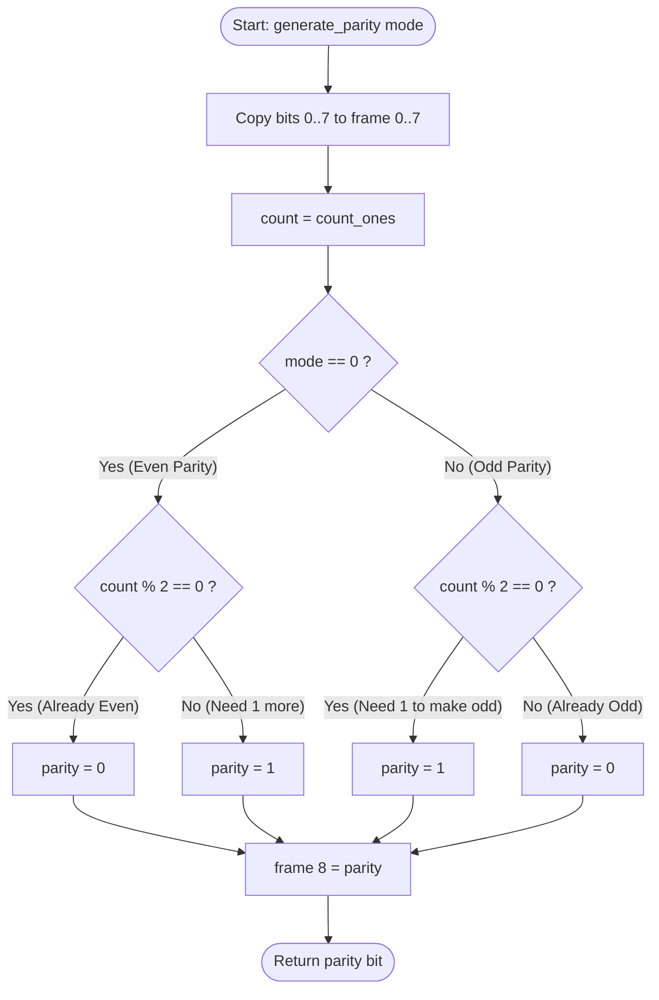
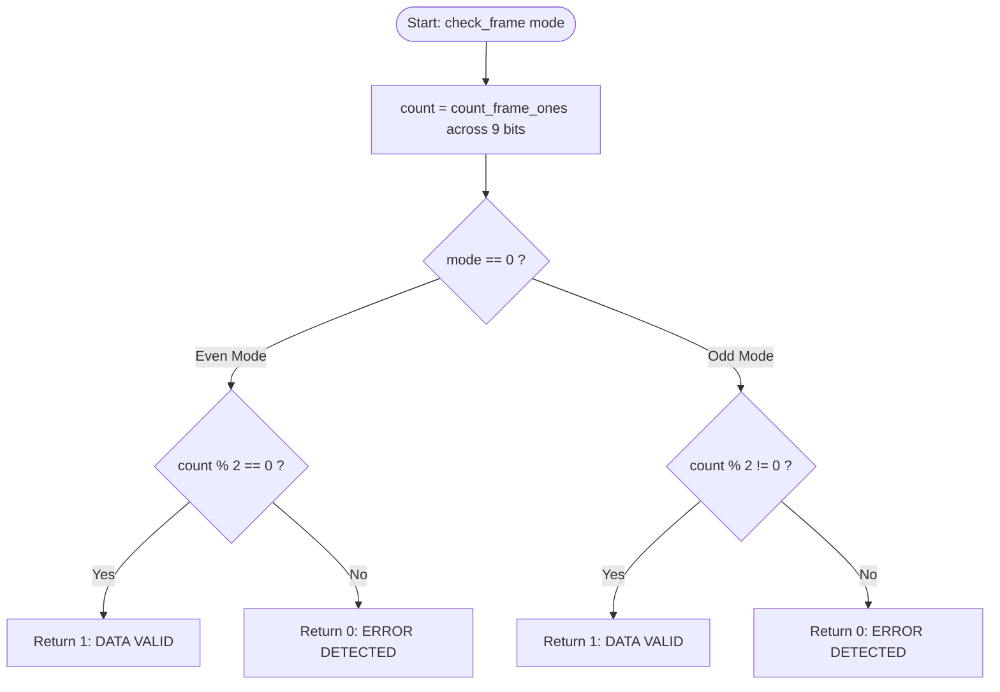

# Software Engineering Documentation: Even/Odd Parity Bit Generator & Checker

**Course / Level:** Undergraduate Computer Networks / Systems Programming Assignment  
**Project:** Even/Odd Parity Bit Generator & Checker  
**Core Implementation:** C (`parity.c`), compiled to WebAssembly (`parity.js`)  
**User Interface:** HTML5, CSS3, Vanilla JavaScript (`index.html`, `style.css`, `script.js`)  

---

## 1. Introduction

### 1.1 Purpose
In digital communication systems and computer networks, binary data travels across physical transmission mediums (such as copper cables, optical fibers, or wireless channels). During transit, environmental factors such as electromagnetic interference (EMI), radio-frequency noise, power fluctuations, or thermal variations can alter electric charges or light pulses, causing one or more bits to flip from `0` to `1` or from `1` to `0`. This corruption leads to invalid messages, data loss, or system crashes.

The purpose of this project is to build an interactive educational simulator that demonstrates **Parity Bit Generation and Error Detection**, a foundational technique in data link layer error control.

### 1.2 What is Parity?
A **parity bit** (also known as a check bit) is an additional binary digit appended to a block of digital data to ensure that the total number of 1-bits in the transmitted frame satisfies a predetermined rule:
- **Even Parity:** The parity bit is set such that the total count of 1s in the entire frame (message bits + parity bit) is **even**.
  - If the original message has an even number of 1s, the parity bit is set to `0`.
  - If the original message has an odd number of 1s, the parity bit is set to `1` (making the total count even).
- **Odd Parity:** The parity bit is set such that the total count of 1s in the entire frame is **odd**.
  - If the original message has an even number of 1s, the parity bit is set to `1` (making the total count odd).
  - If the original message has an odd number of 1s, the parity bit is set to `0`.

### 1.3 Why Noise Causes Errors
When noise flips any single bit during transmission:
- An original even number of 1s becomes odd.
- An original odd number of 1s becomes even.

Upon receiving the frame, the receiver re-counts the total number of 1s across the entire frame. If the count violates the agreed parity rule, the receiver immediately flags an **ERROR DETECTED**.

---

## 2. Requirements

### 2.1 Functional Requirements (FR)
- **FR1 (Message Bit Input):** The user can toggle individual bits of an 8-bit message (`bits[0..7]`) between `0` and `1`.
- **FR2 (Parity Mode Selection):** The user can choose between **Even Parity** (Mode 0) and **Odd Parity** (Mode 1).
- **FR3 (Parity Generation):** The system counts the 1s in the 8-bit message, calculates the correct 9th parity bit, and assembles the 9-bit frame (`frame[0..8]`).
- **FR4 (Channel Noise Simulation):** The user can simulate transmission line noise by clicking any bit of the 9-bit frame to invert it (`0` to `1` or `1` to `0`).
- **FR5 (Receiver Verification):** The receiver counts the total 1s in the received 9-bit frame and evaluates the parity rule, displaying **DATA VALID** or **ERROR DETECTED (Data Corrupted)**.
- **FR6 (State Reset):** The user can reset simulated channel noise or reset the entire simulator to initial state (`bits` cleared to 0).

### 2.2 Non-Functional Requirements (NFR)
- **NFR1 (Zero Frameworks & Complete Simplicity):** No complex libraries, frameworks (React/Vue/Bootstrap), or advanced data structures (structs, hash tables, pointer arithmetic). Only simple 1D C arrays (`int bits[8]` and `int frame[9]`).
- **NFR2 (100% Offline / File Protocol):** The application must open and run directly by double-clicking `index.html` in any modern web browser without requiring a localhost web server or backend runtime.
- **NFR3 (Strict C-Only Core Logic):** All business logic (counting 1s, deciding parity, flipping bits, and checking validity) must execute in native C compiled to WebAssembly. JavaScript is strictly confined to handling user clicks and rendering DOM elements.

---

## 3. Use Case

### 3.1 Actors
1. **Sender (User):** Configures the 8-bit data payload, selects parity mode, and generates the transmission frame.
2. **Channel (Simulator):** Transports the 9-bit frame and allows noise injection (bit flipping).
3. **Receiver (Evaluator):** Receives the 9-bit frame, counts 1s, and validates parity integrity.

### 3.2 Use Case Table

| Use Case ID | Name | Actor | Pre-condition | Main Flow | Expected Outcome |
|---|---|---|---|---|---|
| **UC-01** | Set Message Bits | Sender | App open | Click any bit box (0–7) | Bit toggles between 0 and 1; C array `bits` is updated. |
| **UC-02** | Generate Parity | Sender | Message configured | Click "Generate Parity Bit" | C counts 1s, calculates parity bit, stores in `frame[8]`, and displays 9-bit frame. |
| **UC-03** | Inject Noise | Channel | Frame sent | Click any bit in Panel 2 | C calls `flip_bit(i)`; bit changes value and turns red with alert message. |
| **UC-04** | Reset Noise | Channel | Frame in channel | Click "Reset Noise" | C reloads original clean frame; channel noise cleared. |
| **UC-05** | Verify at Receiver | Receiver | Frame delivered | Click "Deliver to Receiver" | C checks parity rule; displays "DATA VALID" or "ERROR DETECTED". |
| **UC-06** | Reset All | Sender | Any state | Click "Reset All" | All C arrays reset to 0; UI resets to initial state. |

---

## 4. Architectural & Algorithmic Design

### 4.1 Data Structure Memory Layout
Only two plain 1D integer arrays are used in C:

```
bits[8]  (Message Buffer)
+-------+-------+-------+-------+-------+-------+-------+-------+
|  [0]  |  [1]  |  [2]  |  [3]  |  [4]  |  [5]  |  [6]  |  [7]  |
+-------+-------+-------+-------+-------+-------+-------+-------+
    |       |       |       |       |       |       |       |  (Copied)
    v       v       v       v       v       v       v       v
+-------+-------+-------+-------+-------+-------+-------+-------+-------+
|  [0]  |  [1]  |  [2]  |  [3]  |  [4]  |  [5]  |  [6]  |  [7]  |  [8]  |
+-------+-------+-------+-------+-------+-------+-------+-------+-------+
frame[9] (Transmitted Frame Buffer)                             ^ Parity Bit
```

### 4.2 Parity Generation Flowchart



### 4.3 Error Checking Flowchart



---

## 5. Implementation Details

### 5.1 C Functions Overview (`parity.c`)
- `void set_bit(int i, int value)`: Validates index bounds (`0 <= i < 8`) and stores a message bit into `bits[i]`.
- `int count_ones()`: Loops through `bits[0..7]`, incrementing a counter whenever `bits[i] == 1`.
- `int generate_parity(int mode)`: Copies message into `frame[0..7]`, calculates the parity bit according to the selected mode (`mode 0 = Even, 1 = Odd`), saves it in `frame[8]`, and returns it.
- `int get_frame(int i)`: Safely returns `frame[i]` (returns `-1` if index is out of bounds).
- `void flip_bit(int i)`: Simulates channel noise by toggling `frame[i]` from `0` to `1` or `1` to `0`.
- `int count_frame_ones()`: Iterates through all 9 slots of `frame[0..8]` at the receiver and returns the total number of 1s.
- `int check_frame(int mode)`: Compares total frame 1s against the expected parity rule; returns `1` (valid) or `0` (corrupted).
- `int main()`: Interactive console demonstration entry point for running directly in Code::Blocks or GCC without errors.

### 5.2 Why WebAssembly (WASM)?
WebAssembly is an open binary instruction format supported by all modern browsers. Compiling C to WebAssembly allows native C algorithms to execute in the browser client at near-native speed. By compiling with the `-s SINGLE_FILE=1` option, the compiled WebAssembly binary bytecode is base64-embedded directly inside `parity.js`. This eliminates external HTTP requests, allowing `index.html` to be opened immediately from the local filesystem (`file://`) without encountering browser Cross-Origin Resource Sharing (CORS) blocks.

---

## 6. Testing & Verification

The test harness executed all test scenarios against the C WebAssembly engine:

| Test ID | Scenario Description | Input Message `bits[0..7]` | Mode | Injected Noise (Flipped Bit) | Expected 9-Bit Frame | Expected Parity Result | Actual Verification |
|---|---|---|---|---|---|---|---|
| **TC-01** | Even Parity, Clean Channel (Prompt Example) | `[1, 0, 1, 1, 0, 0, 1, 0]` | Even (0) | None | `[1, 0, 1, 1, 0, 0, 1, 0, 0]` | **DATA VALID** (`1`) | **PASS** |
| **TC-02** | Even Parity, Single-Bit Corrupted | `[1, 0, 1, 1, 0, 0, 1, 0]` | Even (0) | Bit `[2]` flipped (`1` &rarr; `0`) | `[1, 0, 0, 1, 0, 0, 1, 0, 0]` | **ERROR DETECTED** (`0`) | **PASS** |
| **TC-03** | Odd Parity, Clean Channel | `[1, 0, 1, 1, 0, 0, 1, 0]` | Odd (1) | None | `[1, 0, 1, 1, 0, 0, 1, 0, 1]` | **DATA VALID** (`1`) | **PASS** |
| **TC-04** | Parity Bit Itself Corrupted | `[1, 0, 1, 1, 0, 0, 1, 0]` | Odd (1) | Bit `[8]` flipped (`1` &rarr; `0`) | `[1, 0, 1, 1, 0, 0, 1, 0, 0]` | **ERROR DETECTED** (`0`) | **PASS** |
| **TC-05** | Boundary Test: All Zeros | `[0, 0, 0, 0, 0, 0, 0, 0]` | Even (0) | None | `[0, 0, 0, 0, 0, 0, 0, 0, 0]` | **DATA VALID** (`1`) | **PASS** |
| **TC-06** | Boundary Test: All Ones with Corruption | `[1, 1, 1, 1, 1, 1, 1, 1]` | Odd (1) | Bit `[0]` flipped (`1` &rarr; `0`) | `[0, 1, 1, 1, 1, 1, 1, 1, 1]` | **ERROR DETECTED** (`0`) | **PASS** |

---

## 7. Conclusions & Real-World Limitations

### 7.1 Key Insights
Parity bit checking is an elegant, computationally lightweight method for detecting single-bit transmission errors. With only one extra bit of transmission overhead per byte, systems can determine whether data received over a noisy link has been altered.

### 7.2 Limitations of Parity Checking
1. **Cannot Correct Errors (Detection Only):** Parity indicates *that* an error occurred, but cannot identify *which* bit flipped. The receiver must request retransmission (ARQ).
2. **Blind to Even Numbers of Bit Flips:** If 2 bits (or 4, 6...) flip simultaneously due to a noise burst, the parity state remains unchanged ($2 \pmod 2 = 0$). In such cases, parity checks fail silently to detect corruption.
3. **Real-World Progression:** Modern production networks use multidimensional checksums (CRC32, Fletcher) or Forward Error Correction codes (Hamming Codes, Reed-Solomon, LDPC) to detect multi-bit errors and automatically reconstruct corrupted data.

---

## 8. "How to Explain This to My Teacher" (1-Minute Talk Script)

> *"Good morning, Professor. For this assignment, I built an Even/Odd Parity Bit Generator and Error Checker simulator.*
>
> *To adhere strictly to systems programming principles, **all core computing logic is implemented entirely in C** inside `parity.c`. The system relies exclusively on basic 1D arrays: `int bits[8]` for the user message and `int frame[9]` for the transmitted frame.*
>
> *Here is how it works:*
> *1. In **Step 1 (Sender)**, the user selects 8 bits and chooses Even or Odd parity. The C function `generate_parity()` counts the ones and computes the 9th parity bit so the entire frame conforms to the parity rule.*
> *2. In **Step 2 (Channel)**, we simulate real-world transmission noise. Clicking any bit invokes C's `flip_bit()`, which simulates electromagnetic interference flipping a bit in transit.*
> *3. In **Step 3 (Receiver)**, the C function `check_frame()` counts the total 1s in the received 9-bit frame. If an odd number of bits were flipped, the parity check fails and triggers an instant **ERROR DETECTED**.*
>
> *To run directly in the browser from `file://` with zero external servers or frameworks, the C code is compiled to WebAssembly with Emscripten using `-s SINGLE_FILE=1`. JavaScript only acts as a thin presentation layer calling the exported C functions through `cwrap`.*
>
> *Thank you, and I would be glad to answer any questions or demonstrate a test case!"*
